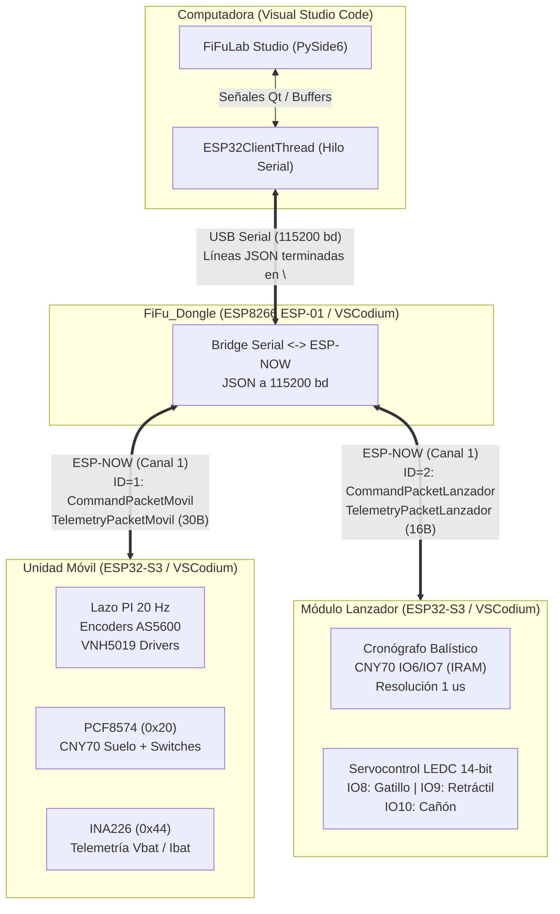
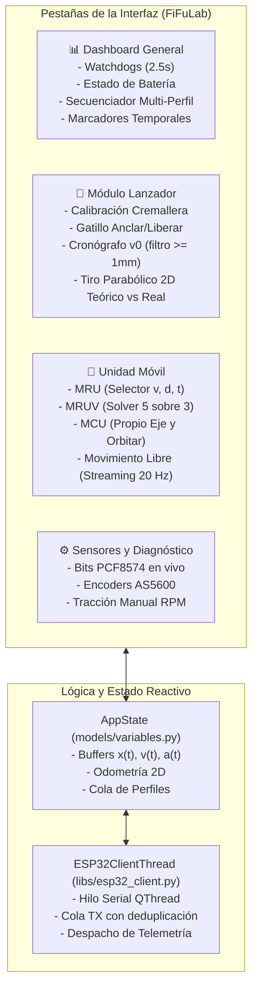

# FiFuLab — Plataforma Experimental de Cinemática y Balística con Telemetría Inalámbrica (ESP-NOW)

Sistema integral de hardware y software para el estudio, análisis experimental y visualización en tiempo real de fenómenos de física mecánica: **Movimiento Rectilíneo Uniforme (MRU)**, **Movimiento Rectilíneo Uniformemente Variado (MRUV)**, **Movimiento Circular Uniforme (MCU / Odometría Diferencial)**, **Movimiento Libre Arbitrario por Streaming Dinámico** y **Lanzamiento de Proyectiles con Cronógrafo Balístico de Alta Precisión**.

---

## 📁 1. Estructura y Organización del Proyecto

El proyecto está diseñado para dividirse de forma limpia en dos grandes ramas de publicación: **Firmware** (hardware embebido) y **Software** (aplicación de escritorio).

```text
PG_RGA_Software/
├── Firmware/                                  # Proyectos embebidos (Visual Studio Codium + PlatformIO)
│   ├── FiFu_Dongle/                          # Módulo Dongle Receptor (ESP8266)
│   │   ├── include/espnow_protocol.h         # Definición unificada de estructuras binarias ESP-NOW
│   │   ├── src/main.cpp                      # Bridge bidireccional ESP-NOW <-> JSON Serial USB
│   │   └── platformio.ini                    # Configuración de entorno PlatformIO (esp01_1m)
│   │
│   ├── Prueba_esp32/ (FiFu_Movil)/           # Unidad Móvil Cinemática (ESP32-S3 Mini / DevKit)
│   │   ├── include/espnow_protocol.h         # Protocolo común de tramas y comandos
│   │   ├── src/main.cpp                      # Lazo de control PI (20 Hz), odometría y cinemática
│   │   └── platformio.ini                    # Configuración de entorno PlatformIO (esp32-s3-devkitc-1)
│   │
│   └── FiFu_Lanzador/                        # Módulo Lanzador Balístico (ESP32-S3 Mini / DevKit)
│       ├── include/espnow_protocol.h         # Protocolo común de tramas y comandos
│       ├── src/main.cpp                      # Cronógrafo (IRAM), servocontrol 14-bit y telemetría
│       └── platformio.ini                    # Configuración de entorno PlatformIO (esp32-s3-devkitc-1)
│
└── Software/                                  # Aplicación de escritorio (Visual Studio Code + Python)
    └── FiFuLab/                              # GUI completa en PySide6 (Qt6) + PyQtGraph
        ├── main.py                           # Punto de entrada principal y bootstrap
        ├── requirements.txt                  # Dependencias de Python (PySide6, numpy, pyserial)
        ├── ui/                               # Vistas y pestañas principales de la interfaz
        │   ├── main_window.py                # Ventana principal, navegación y barra de estado
        │   ├── dashboard_tab.py              # Pestaña 1: Dashboard General y Secuenciador de Perfiles
        │   ├── launcher_tab.py               # Pestaña 2: Módulo Lanzador y Balística 2D
        │   ├── mobile_tab.py                 # Pestaña 3: Unidad Móvil (MRU, MRUV, MCU, Libre)
        │   └── tab_sensores.py               # Pestaña 4: Diagnóstico y Placa Perimetral
        ├── models/                           # Estado reactivo y lógica del dominio
        │   ├── variables.py                  # AppState, odometría, adquisición y buffers
        │   └── translations.py               # Soporte multi-idioma (Español / Inglés)
        ├── libs/                             # Comunicación con hardware y dependencias locales
        │   ├── esp32_client.py               # Hilo de comunicación serie, cola TX y watchdogs
        │   └── pyqtgraph/                    # Librería optimizada de graficación vectorial
        ├── components/                       # Componentes interactivos reutilizables
        │   ├── canvas_widget.py              # Lienzo táctil para dibujo a mano de perfiles
        │   ├── navbar.py                     # Barra superior de conexión serie y estado
        │   └── modals.py                     # Modales de guardado de perfil, triggers y ajustes
        └── styles/                           # Hojas de estilo QSS y temas (Dark / Light)
```

---

## 🛠️ 2. Entornos y Herramientas de Desarrollo

| Componente | Entorno de Desarrollo (IDE) | Plataforma / Framework | Lenguaje / Tecnologías |
| :--- | :--- | :--- | :--- |
| **Firmware Embebido** | **Visual Studio Codium** | PlatformIO IDE | C++17, Arduino Core, FreeRTOS, ESP-NOW |
| **Software de Escritorio** | **Visual Studio Code** | Python 3.10+ | PySide6 (Qt6), PyQtGraph, NumPy, PySerial |

---

## 🌐 3. Arquitectura del Sistema y Flujo de Comunicación

La comunicación entre la computadora y las unidades robóticas es totalmente inalámbrica y opera en **Canal WiFi 1** con protocolo **ESP-NOW** a 2.4 GHz de ultra-baja latencia (< 1 ms).



### Protocolo de Paquetes Binarios (`espnow_protocol.h`)
* **Telemetría Móvil (`TelemetryPacketMovil` - 30 bytes, 10 Hz):**
  * `mode_state` (0=IDLE, 1=MRU, 2=MRUV, 3=MCU, 4=MANUAL, 5=COLISIÓN).
  * `perimetral` (byte de sensores PCF8574).
  * `v_bat_v`, `i_bat_a` (voltaje y corriente de batería LiPo medidos por el INA226).
  * `rpm_l`, `rpm_r`, `sp_rpm_l`, `sp_rpm_r` (velocidades angulares medidas y consignas).
  * `progress_pct` (progreso cinemático 0 a 1000 = 0.0% a 100.0%).
* **Telemetría Lanzador (`TelemetryPacketLanzador` - 16 bytes, 10 Hz):**
  * `ang_gatillo` (IO8), `ang_retractil` (IO9), `ang_canon` (IO10).
  * `flags` (estado de barreras ópticas, servos y armado).
  * `shot_id` (contador de disparos), `dt_us` (tiempo de vuelo en $\mu s$), `v_salida_ms` ($v_0$ en m/s).
* **Comandos Móvil (`CommandPacketMovil` - 16 bytes):**
  * `cmd_mode` (0=STOP, 1=MRU, 2=MRUV, 3=MCU, 4=DIRECT_RPM).
  * `param1`, `param2`, `duration_s`.
* **Comandos Lanzador (`CommandPacketLanzador` - 5 bytes):**
  * `cmd_action` (1=Mover Servo, 2=Buzzer, 3=Reset Cronógrafo), `servo_pin`, `servo_ang`.

---

## 🤖 4. Módulos de Hardware y Firmware (VSCodium + PlatformIO)

### 4.1 Unidad Móvil (`Prueba_esp32` / `FiFu_Movil`)
Robot diferencial de alta precisión cinemática para ensayos de laboratorio.
* **Microcontrolador:** ESP32-S3 Mini / DevKitC-1.
* **Tracción y Potencia:** 2 Motores DC con reductora accionados por un puente en H dual **Pololu VNH5019** a **20 kHz PWM** (libre de zumbidos audibles) con corte electromagnético a GND en ambos terminales al detenerse y zona muerta calibrada (`PWM_DEADZONE = 22`).
* **Encoders Magnéticos:** 2 sensores magnéticos de ángulo absoluto **AS5600 (12 bits / 4096 cuentas por vuelta)** montados directamente en el eje de rueda ($D = 60\text{ mm}$), conectados en buses I2C físicos independientes para evitar colisiones de dirección:
  * **Bus 0 (Wire):** Rueda Derecha en pines `IO2 (SDA)` y `IO3 (SCL)`.
  * **Bus 1 (Wire1):** Rueda Izquierda en pines `IO12 (SDA)` y `IO13 (SCL)`.
* **Sensor de Energía:** **INA226** (dirección `0x44` en bus Wire1) con lectura en tiempo real de voltaje de batería LiPo (12.8V a 16.8V) y corriente total consumida con precisión de mA.
* **Placa Perimetral Frontal:** Expansor I2C **PCF8574** (dirección `0x20` en bus Wire1):
  * **Bit 0 (P0):** Sensor Óptico CNY70 Frontal Izquierdo (`1 = Suelo detectado`, `0 = En el aire / Desnivel`).
  * **Bit 1 (P1):** Sensor Óptico CNY70 Frontal Derecho (`1 = Suelo detectado`, `0 = En el aire / Desnivel`).
  * **Bit 2 (P2):** Microswitch Frontal Izquierdo (`0 = Contacto / Impacto`, `1 = Libre`).
  * **Bit 3 (P3):** Microswitch Frontal Derecho (`0 = Contacto / Impacto`, `1 = Libre`).
  * **Bit 4 (P4):** Sensor Touch capacitivo (`1 = Contacto táctil`, `0 = Libre`).
* **Lazo de Control:** Tarea FreeRTOS en Core 1 a **20 Hz (50 ms)** con controladores PI sintonizados por método Lambda ($K_p = 0.34$, $K_i = 3.20$, $K_{ff} = 0.52 - 0.54$) con compensación dinámica de batería.

### 4.2 Módulo Lanzador Balístico (`FiFu_Lanzador`)
Cañón electromecánico para ensayos de cinemática de proyectiles y conservación de energía.
* **Microcontrolador:** ESP32-S3 Mini / DevKitC-1.
* **Cronógrafo Balístico:** 2 barreras ópticas CNY70 separadas exactamente **$d = 8.0\text{ mm}$**:
  * **Sensor 1 (Inicio):** Pin `IO6` con interrupción IRAM de flanco (`isrSensor1`).
  * **Sensor 2 (Fin):** Pin `IO7` con interrupción IRAM de flanco (`isrSensor2`).
  * **Cálculo de Velocidad de Salida:** $v_0 = \frac{8000.0}{\Delta t_{\mu s}}\text{ [m/s]}$ con timeout de seguridad de 500 ms.
* **Servomotores LEDC (14 bits / 16384 cuentas a 50 Hz):**
  * **Pin IO8 (Gatillo):** 90° (anclado bajo resorte) y 108° (liberación).
  * **Pin IO9 (Mecanismo Retráctil / Compresión):** Cremallera y piñón con módulo $m = 1.0\text{ mm}$, $Z = 16$ dientes. Paso de compresión: $0.139626\text{ mm/°}$. Rango operativo: Tope de reposo a 20°, compresión 0.0 mm en 45°, compresión máxima de 95° ($\Delta x \approx 6.98\text{ mm}$).
  * **Pin IO10 (Elevación de Cañón):** 90° (0° horizontal) a 180° (90° tiro vertical).
  * **Protección Acústica y Térmica:** Duty cycle cortado a 0V (LOW puro) tras 800 ms de movimiento para eliminar vibraciones parasitarias y recalentamiento de servos sin destruir timers.
* **Periféricos:** Buzzer piezoeléctrico no bloqueante en `IO4`, LED NeoPixel RGB de estado en `IO2`.

### 4.3 Dongle Receptor (`FiFu_Dongle`)
Puente de comunicaciones serie a radiofrecuencia.
* **Microcontrolador:** ESP8266 (ESP-01 / 1MB flash) a 115200 baudios.
* Recibe paquetes binarios ESP-NOW de Móvil (`src=1`) y Lanzador (`src=2`), los formatea en JSON estructurado (`ArduinoJson 7`) y los transmite por USB a la PC a 10 Hz.
* Recibe comandos JSON desde Python, los valida y los transmite como paquetes binarios empaquetados hacia la MAC correspondiente.

---

## 💻 5. Software de Escritorio (`FiFuLab` — VS Code)

Aplicación gráfica moderna de laboratorio desarrollada con **PySide6 (Qt6)** y **PyQtGraph**, con soporte bilingüe (Español / Inglés) y temas Dark/Light.



### Funcionalidades Destacadas por Pestaña
1. **Dashboard General:**
   * Indicadores de enlace con watchdog independiente de 2.5s para Dongle, Móvil y Lanzador.
   * Telemetría de batería (voltaje, corriente de consumo y porcentaje con barra de color).
   * **Secuenciador Multi-Perfil:** Tabla de perfiles cinemáticos encadenados con gráfica general $v(t)$ y $x(t)$, marcadores visuales de transición temporal ($P_1, P_2, \dots$) y botones de reproducción secuencial automática.
2. **Módulo Lanzador:**
   * Selector milimétrico y angular de compresión de resorte con calibración de cremallera.
   * Disparo seguro: el cronógrafo solo computa mediciones balísticas válidas si la compresión es $\ge 1.0\text{ mm}$.
   * Gráfica 2D de tiro parabólico comparando alcance horizontal ($X_{max}$) y altura máxima ($Y_{max}$) teóricos vs. reales.
3. **Unidad Móvil:**
   * **MRU:** El usuario selecciona la variable que desea calcular ($v$, $d$ o $t$); el sistema bloquea su campo, la calcula analíticamente y valida las físicas. Ajuste de curvas (Lineal/Cuadrático con $R^2$).
   * **MRUV:** El usuario marca exactamente 3 casillas de las 5 disponibles ($v_0, v_f, a, d, t$); el solucionador analítico resuelve la combinación elegida de las 10 posibles ($\binom{5}{3}$) y grafica $x-t$, $v-t$ y $a-t$.
   * **MCU (Movimiento Circular Uniforme):**
     * *Giro sobre su propio eje:* Parámetros de velocidad angular $\omega$, duración por tiempo o por ángulo de giro, sentido horario/antihorario. Gráfica 2D deshabilitada por tratarse de un giro estático sin traslación.
     * *Orbitar:* Órbita circular 2D centrada en el origen $(0,0)$. El robot inicia sobre el radio en $(0, +R)$ para giro horario o $(0, -R)$ para antihorario, logrando que la trayectoria real medida por odometría coincida con la órbita teórica punteada.
   * **Movimiento Libre (Dibujo a Mano):**
     * Lienzo interactivo para trazar curvas libres de posición $x(t)$, velocidad $v(t)$ o aceleración $a(t)$.
     * **Streaming Dinámico a 20 Hz (Modo 4):** La interfaz interpola en tiempo real la velocidad de la curva y transmite consignas instantáneas de RPM a los motores, permitiendo al robot acelerar, desacelerar y sostener velocidades variables con fidelidad física.
4. **Diagnóstico y Sensores:**
   * Monitoreo en tiempo real de los 5 bits perimetrales del PCF8574 con tarjetas reactivas: CNY70 izquierdo y derecho (suelo/aire), microswitches izquierdo y derecho (contacto/libre) y sensor touch.
   * Control manual de motores en lazo abierto/RPM directo.

---

## 🚀 6. Guía de Instalación y Puesta en Marcha

### 6.1 Compilación y Carga del Firmware (VSCodium + PlatformIO)

#### Requisitos Previos:
1. Instalar **VSCodium** (o VS Code).
2. Instalar la extensión **PlatformIO IDE** (`platformio.platformio-ide`).

#### Pasos de Carga:
1. Conectar la placa correspondiente a la computadora mediante cable USB.
2. Abrir la carpeta del proyecto en VSCodium (por ejemplo `Prueba_esp32` o `FiFu_Lanzador`).
3. En la barra inferior de PlatformIO, verificar que el entorno (`env`) coincida con el microcontrolador:
   * Para **FiFu_Dongle**: `env:esp01_1m`
   * Para **Prueba_esp32 (Móvil)**: `env:esp32-s3-devkitc-1`
   * Para **FiFu_Lanzador**: `env:esp32-s3-devkitc-1`
4. Compilar y cargar el código presionando el botón **PlatformIO: Upload** ($\rightarrow$) o ejecutando en la terminal integrada:
   ```bash
   pio run -t upload
   ```
5. *(Opcional)* Abrir el monitor serial a 115200 baudios para verificar inicialización:
   ```bash
   pio device monitor -b 115200
   ```

---

### 6.2 Ejecución del Software (VS Code + Python)

#### Requisitos Previos:
* Python 3.10 o superior instalado y agregado al `PATH`.
* Conectar el **Dongle ESP8266** al puerto USB de la computadora.

#### Pasos de Instalación y Ejecución:
1. Abrir la carpeta `FiFuLab` en **Visual Studio Code**.
2. Abrir una terminal en `FiFuLab` y crear un entorno virtual de Python:
   ```powershell
   # En Windows PowerShell:
   python -m venv venv
   .\venv\Scripts\Activate.ps1
   ```
3. Instalar las dependencias requeridas:
   ```bash
   pip install -r requirements.txt
   ```
4. Iniciar la aplicación:
   ```bash
   python main.py
   ```
5. En la barra superior de la aplicación (**Navbar**):
   * Seleccionar el puerto serie del Dongle (ej. `COM3` o `COM4`).
   * Presionar **"Conectar"**. Los indicadores de estado se iluminarán en verde al sincronizar la telemetría del robot móvil y del lanzador.

---

## 🔍 7. Solución de Problemas (Troubleshooting)

| Síntoma | Causa Posible | Solución |
| :--- | :--- | :--- |
| **El Dongle no aparece en la lista de puertos COM** | Falta de driver USB-Serial (CH340 / CP2102). | Instalar el controlador oficial CH340/CH341SER o Silicon Labs CP210x según la placa. |
| **El Dongle conecta pero no muestra datos del Móvil o Lanzador** | Dispositivos apagados o canal WiFi desalineado. | Verificar alimentación de batería LiPo (>12.8V) en el robot móvil y confirmar que todos los proyectos usen `CANAL_WIFI = 1`. |
| **Los motores no giran al ejecutar perfiles** | Batería desconectada o interruptor del driver en OFF. | Verificar telemetría de batería en el Dashboard. El firmware bloquea tracción si $V_{bat} < 10.0\text{ V}$ para proteger la batería LiPo. |
| **El cronógrafo del lanzador no registra disparos** | Compresión menor a 1.0 mm o barreras ópticas desalineadas. | Retraer el resorte al menos a 1.0 mm ($>52^\circ$). Limpiar los reflectores infrarrojos de los CNY70 en IO6 e IO7. |
| **En Movimiento Libre el robot no sigue la curva** | Comunicación serial saturada o desconexión momentánea. | La aplicación cuenta con deduplicación de cola para comandos de velocidad a 20 Hz. Mantener el cable USB del Dongle firme y sin concentradores pasivos. |

---

## 👥 8. Créditos y Licencia
Desarrollado como plataforma docente y experimental para el laboratorio de física mecánica y mecatrónica.  
Diseño de hardware, firmware y software bajo licencia abierta para propósitos educativos e investigación científica.
